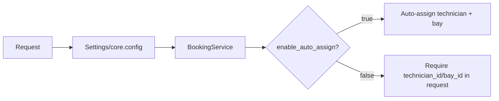

# Implementation Plan — Appointment Scheduler Backend

**Author role:** Principal Backend Engineer / Technical Lead (planning document)
**Context:** One-week take-home assessment, ~2 hours/day availability (~14–16h weekday budget, up to 18h including optional weekend buffer)
**Status:** Pre-development plan — no code written yet
**Related documents:** [docs/architecture.md](docs/architecture.md) (C4-style diagrams), [docs/ADR/](docs/ADR/) (Architecture Decision Records)

---

## 1. Project Objective

The goal of this assessment is to design and implement a backend service that manages vehicle service appointments across dealerships — validating vehicles and service types, automatically assigning an available technician and service bay, and preventing double-booking through correct transactional and concurrency handling.

The purpose of this exercise is not to demonstrate breadth of technology, but depth of engineering judgment: clean layering (API / service / repository), correct handling of a real concurrency problem (overlapping bookings), observability primitives (correlation IDs, structured logs), and a codebase that is easy to extend and reason about. Every design decision below is made to optimize for **passing a one-week backend take-home assessment**, not for building a real production system — scope is deliberately constrained so that the delivered slice is complete, tested, and well-documented rather than broad and shallow.

---

## 2. Scope

### Must Have (the assessment fails without these)

- `POST /appointments` — create appointment with backend-driven technician/bay assignment
- `GET /appointments`, `GET /appointments/{id}` — read appointment(s)
- `DELETE /appointments/{id}` — cancel an appointment
- `GET /availability` — query open slots for a dealer/service type
- Entities: Dealer, Vehicle, Technician, Service Bay, Service Type, Appointment
- Overlap prevention (appointment / technician / bay / vehicle) inside a DB transaction
- Repository + Service layer separation
- API versioning prefix (`/api/v1`) — zero-cost, already part of the frozen API contract (Section 10)
- Alembic migrations + Docker Compose (api + postgres)
- Correlation ID middleware + structured request logging
- Standardized error response shape
- Unit tests for booking logic + at least one integration test
- README with setup/run/test instructions

### Should Have (adds credibility, safe to include if time allows)

- Feature toggles (`ENABLE_AUTO_ASSIGN`, `ENABLE_OVERLAP_VALIDATION`, `ENABLE_STRUCTURED_LOGGING`)
- Health check endpoint (`/health`)
- System design document (architecture + sequence + ERD) in `docs/architecture.md`
- Architecture Decision Records (`docs/ADR/`) for the 3-5 most interview-relevant decisions
- Seed script / fixture data for manual testing

### Nice to Have (cut first if time runs out)

- `GET /availability` returning fine-grained time slot suggestions (vs. simple boolean/list)
- Pagination on `GET /appointments`
- Basic rate-limit-style guard rail (in-memory, no Redis)
- Postman/HTTPie collection in repo

**Rule of thumb:** everything outside "Must Have" can be deleted the night before submission without invalidating the assessment. This list exists so scope-cutting decisions are made _now_, not under deadline pressure.

---

## 3. Non-Goals

Explicitly out of scope, with rationale:

| Excluded                             | Why                                                                                                                                                     |
| ------------------------------------ | ------------------------------------------------------------------------------------------------------------------------------------------------------- |
| Terraform / IaC                      | No cloud environment to provision; would be theater, not signal.                                                                                        |
| Kubernetes                           | Single-service Docker Compose is sufficient to prove containerization competency; K8s adds ops surface with zero business-logic value here.             |
| Redis                                | No caching or distributed lock requirement at this scale; Postgres row locking (`SELECT FOR UPDATE`) is sufficient and simpler to reason about.         |
| Kafka / RabbitMQ                     | No async workflow or cross-service event requirement; introducing a broker would be unjustified complexity for a synchronous CRUD+booking API.          |
| Cloud deployment (AWS/GCP/Azure)     | Assessment is evaluated locally via Docker Compose; cloud deployment tests infra skills, not backend design.                                            |
| Authentication / Authorization       | Not specified in requirements; adding a half-implemented auth layer is worse than omitting it and stating the assumption explicitly.                    |
| Notifications (email/SMS)            | No delivery channel specified; out of the core booking domain.                                                                                          |
| OpenTelemetry / Prometheus / Grafana | Correlation ID + structured logs already demonstrate observability _thinking_; full metrics/tracing stack is disproportionate to a 1-week solo project. |
| Multi-language / i18n                | Single-locale assumption keeps validation and error messages simple.                                                                                    |
| Frontend / UI                        | Backend-only assessment.                                                                                                                                |

If asked in interview _"why not X?"_, the standard answer is: _"Given the one-week scope, I prioritized correctness and clarity of the core booking domain over infrastructure breadth. X would be justified once we have [multi-service / real traffic / compliance] pressure, which doesn't exist yet."_

---

## 4. Assumptions

Because the challenge brief leaves several details open, the following assumptions are made explicit and documented (rather than silently guessed):

- Single timezone for the whole system (no per-dealer timezone handling); all timestamps stored/compared in UTC.
- Appointment duration is derived entirely from `service_types.duration_minutes` — client cannot override it.
- No recurring appointments — every appointment is a single, one-off booking.
- No holiday calendars or technician time-off tracking — technician "availability" is defined purely by absence of overlapping appointments within a basic working-hours window (e.g., 08:00–18:00), configurable via constant, not per-technician schedule.
- A single appointment belongs to exactly one dealer; a request cannot span multiple dealers.
- Technician and service bay must belong to the same dealer as the vehicle/appointment (no cross-dealer assignment).
- One technician and one bay per appointment (no multi-technician jobs).
- Soft business hours are fixed system-wide constants, not configurable per dealer, to keep scope small.
- Cancellation (`DELETE`) is a soft-status transition to `CANCELLED` (row retained, not deleted) rather than a hard delete or a full audit/history table — see ADR-006.
- No payment, pricing, or invoicing concerns — purely scheduling.
- Concurrency correctness is scoped to "no two appointments can double-book the same technician/bay/time window," not full distributed-systems-grade guarantees.
- Data volume is small enough that no partitioning, archival, or read-replica strategy is needed.

---

## 5. Architecture Overview

The system is a single FastAPI monolith backed by PostgreSQL, structured in layers to keep business logic testable and independent of the web/framework and persistence details:

- **API layer** — FastAPI routers, request/response validation (Pydantic schemas), HTTP concerns only.
- **Service layer** — business logic and orchestration (booking flow, availability calculation, validation rules); framework-agnostic, unit-testable in isolation.

The stack uses FastAPI's synchronous request-handling path with a synchronous SQLAlchemy 2 engine/session (`psycopg`), not `asyncpg`/async SQLAlchemy — see ADR-001 amendment. This keeps transaction/session handling and test fixtures simple, which matters more than async I/O throughput at this scale (single instance, local Docker Compose, no real concurrent load target).

- **Repository layer** — data access using SQLAlchemy 2; isolates ORM/query details from services, making them swappable/mockable in tests.
- **Core** — cross-cutting concerns: configuration, logging, middleware (correlation ID, request logging), centralized exception handling.

Requests flow API → Service → Repository → DB, with the Service layer owning the transaction boundary for the booking use case so that technician/bay assignment and appointment creation are atomic. The application is stateless; all state lives in PostgreSQL. Docker Compose provides a two-container local environment (`api`, `postgres`); Alembic manages schema evolution independent of application deploys.

This layering is intentionally the same shape a multi-service system would use, so the reasoning ("why does a monolith need a correlation ID / clean layering?") transfers directly to a future decomposition without a rewrite.

---

## 6. Domain Model

| Entity           | Responsibility                                                                                                                                                            | Key Relationships                                                           |
| ---------------- | ------------------------------------------------------------------------------------------------------------------------------------------------------------------------- | --------------------------------------------------------------------------- |
| **Dealer**       | Represents a dealership location; scopes all other entities (a technician, bay, or vehicle belongs to one dealer).                                                        | 1 → many Vehicles, Technicians, Service Bays, Appointments                  |
| **Vehicle**      | Represents the customer vehicle being serviced; owned by/associated with a dealer.                                                                                        | belongs to 1 Dealer; 1 → many Appointments                                  |
| **Technician**   | A staff member who can be assigned to perform a service; has a dealer and (optionally) skill tags.                                                                        | belongs to 1 Dealer; 1 → many Appointments                                  |
| **Service Bay**  | A physical bay/slot resource required to perform the service; limits concurrent appointments.                                                                             | belongs to 1 Dealer; 1 → many Appointments                                  |
| **Service Type** | Defines the kind of work (e.g., oil change) and its fixed `duration_minutes`, used to compute appointment end time.                                                       | referenced by many Appointments                                             |
| **Appointment**  | The booking itself: links vehicle + service type + dealer + assigned technician + assigned bay + time window + status. Central aggregate enforcing no-overlap invariants. | belongs to 1 Dealer, 1 Vehicle, 1 Service Type, 1 Technician, 1 Service Bay |

Appointment is the only entity with real business-rule enforcement (overlap, assignment); all others are largely reference/master data for this exercise.

---

## 7. Folder Structure

```
app/
    api/            # FastAPI routers + request/response wiring only (no business logic)
    core/
        config.py      # env-driven settings, feature toggle flags
        logging.py      # structlog/logging configuration
        middleware.py    # correlation ID + request logging middleware
        exceptions.py    # exception types + centralized handler → standardized error shape
    db/             # engine/session setup, base declarative model, transaction helpers
    models/           # SQLAlchemy ORM models (persistence shape only)
    repositories/       # data-access classes, one per aggregate (query logic lives here, not in services)
    services/          # business logic (booking flow, availability, validation) — framework-agnostic
    schemas/          # Pydantic request/response DTOs (kept separate from ORM models on purpose)
    utils/            # small shared helpers (e.g., UUIDv7 generation, time-window overlap math)

tests/
    unit/            # service-layer tests with repositories mocked/faked
    integration/        # API-level tests against a real test database

migrations/          # Alembic revisions
docker-compose.yml     # api + postgres services
README.md
IMPLEMENTATION_PLAN.md
```

Rationale: separating `schemas/` (API contracts) from `models/` (DB shape) prevents leaking persistence details into the API and vice versa; `repositories/` isolates SQLAlchemy so `services/` can be unit-tested without a database; `core/` groups cross-cutting concerns so they aren't scattered across route handlers.

---

## 8. Development Strategy

Development is broken into sequential phases; each phase produces something runnable/verifiable before moving on.

### Phase 0 — Setup & Design (~2h)

- **Goal:** Lock down requirements interpretation and data model before writing code.
- **Deliverables:** This plan finalized, ERD sketch, endpoint contracts written down.
- **Estimate:** 2h

### Phase 1 — Project Skeleton (~1.5h)

- **Goal:** Runnable FastAPI app with config, logging, Docker Compose, health endpoint.
- **Deliverables:** `app/main.py`, `core/config.py`, `docker-compose.yml`, `/health` returns 200.
- **Estimate:** 1.5h

### Phase 2 — Data Layer (~2h)

- **Goal:** Schema exists and is migratable.
- **Deliverables:** SQLAlchemy models for all 6 entities, first Alembic migration, `alembic upgrade head` works against Compose Postgres.
- **Estimate:** 2h

### Phase 3 — Repository + Service Layer (~2.5h)

- **Goal:** Booking business logic implemented and unit-testable without HTTP.
- **Deliverables:** Repositories for each entity, `BookingService` implementing the validate → assign → check-overlap → transaction flow.
- **Estimate:** 2.5h

### Phase 4 — API Layer (~1.5h)

- **Goal:** All 5 endpoints wired end-to-end.
- **Deliverables:** Routers + Pydantic schemas for appointments and availability; manual smoke test via curl/HTTPie.
- **Estimate:** 1.5h

### Phase 5 — Observability (~1h)

- **Goal:** Correlation ID, structured logging, standardized error responses working.
- **Deliverables:** Middleware + exception handler; verified via manual request with/without `X-Correlation-ID`.
- **Estimate:** 1h

### Phase 6 — Testing (~2h)

- **Goal:** Confidence in overlap/assignment logic.
- **Deliverables:** Unit tests (success, overlap, no technician, no bay) + 1 integration test for `POST /appointments`.
- **Estimate:** 2h

### Phase 7 — Docs & Polish (~2h)

- **Goal:** Reviewer can run the project in under 5 minutes and understand design decisions.
- **Deliverables:** README (architecture, run, docker, migration, API, testing, AI collaboration), short system design doc.
- **Estimate:** 2h

### Phase 8 — Buffer (~2h)

- **Goal:** Absorb underestimates, fix bugs found late, polish rough edges.
- **Estimate:** 2h

**Total: ~14–16h weekday budget**, consistent with the ~2h/day target over one week (see Section 16 for the optional weekend buffer).

---

## 9. Business Rules

| Rule                                                                    | Why it exists                                                                                                                                                     |
| ----------------------------------------------------------------------- | ----------------------------------------------------------------------------------------------------------------------------------------------------------------- |
| Client cannot specify `technician_id` on booking creation               | Prevents clients from bypassing availability logic and encoding assignment policy on the frontend; keeps assignment logic centralized and changeable server-side. |
| Appointment duration = service type's `duration_minutes`                | Guarantees consistent, predictable scheduling and prevents client-supplied durations from corrupting availability calculations.                                   |
| No overlapping appointments for the same technician                     | A technician cannot physically perform two jobs at once — core scheduling invariant.                                                                              |
| No overlapping appointments for the same service bay                    | A bay is a physical resource; two vehicles cannot occupy it simultaneously.                                                                                       |
| No overlapping appointments for the same vehicle                        | A vehicle cannot be serviced twice concurrently at the same or different dealer.                                                                                  |
| Vehicle and requested dealer must match (dealer mismatch check)         | Prevents booking a vehicle at a dealer it has no relationship with (data integrity / business validity).                                                          |
| Technician and bay must belong to the requested dealer                  | Prevents cross-dealer resource assignment, which would be operationally meaningless.                                                                              |
| Appointment must fall within defined business hours                     | Avoids scheduling work outside operating hours where no staff/bay would realistically be available.                                                               |
| Booking is atomic (all checks + assignment + insert in one transaction) | Prevents race conditions where two concurrent requests could both "see" the same free technician/bay and double-book it.                                          |

---

## 10. API Design

All endpoints are versioned under `/api/v1`. No implementation details below — contract only.

### `POST /api/v1/appointments`

- **Purpose:** Create a new appointment; backend selects technician and bay.
- **Request:** `dealer_id`, `vehicle_id`, `service_type_id`, `start_time` (requested), optional `notes`.
- **Validation:** vehicle exists and belongs to dealer; service type exists; start_time within business hours; no `technician_id`/`bay_id` accepted from client (rejected if present, to make the contract explicit rather than silently ignored).
- **Expected response:** `201 Created` with full appointment object (id, assigned technician, assigned bay, computed end_time, status). `409 Conflict` if no technician/bay available. `422` for validation errors. `404` if vehicle/dealer/service type not found.

### `GET /api/v1/appointments`

- **Purpose:** List appointments, filterable.
- **Query params:** `dealer_id` (required — `422` if absent), optional `date`, `technician_id`, `status`.
- **Validation:** at least one scoping filter recommended to avoid unbounded scans.
- **Expected response:** `200 OK` with array of appointment summaries.

### `GET /api/v1/appointments/{id}`

- **Purpose:** Fetch a single appointment.
- **Validation:** id must be a valid UUID.
- **Expected response:** `200 OK` with full appointment detail; `404` if not found.

### `DELETE /api/v1/appointments/{id}`

- **Purpose:** Cancel an appointment.
- **Validation:** appointment must exist and not already be cancelled/completed.
- **Expected response:** `204 No Content` on success; `404` if not found; `409` if already cancelled.

### `GET /api/v1/availability`

- **Purpose:** Report open slots/resources for a dealer + service type over a date range.
- **Query params:** `dealer_id`, `service_type_id`, `date` (or date range).
- **Validation:** dealer and service type must exist; date range bounded (e.g., max 7 days) to keep the query cheap.
- **Expected response:** `200 OK` with a list of candidate time slots and/or count of available technicians/bays per slot.

### `GET /health`

- **Purpose:** Liveness/readiness check for Docker/orchestration, including a database connectivity probe (not just process liveness).
- **Expected response:** `200 OK` when healthy:

```json
{
  "status": "UP",
  "database": "UP",
  "version": "1.0.0"
}
```

`503 Service Unavailable` with `"database": "DOWN"` if the DB ping fails, so the check is meaningful rather than a static 200.

---

## 11. Database Design

### Tables

- `dealers(id, name, timezone, created_at)`
- `vehicles(id, dealer_id FK, vin, owner_name, created_at)`
- `technicians(id, dealer_id FK, name, created_at)`
- `service_bays(id, dealer_id FK, name, created_at)`
- `service_types(id, name, duration_minutes, created_at)`
- `appointments(id, dealer_id FK, vehicle_id FK, service_type_id FK, technician_id FK, bay_id FK, start_time, end_time, status, created_at)`

### Indexes

- `appointments(technician_id, start_time, end_time)` — overlap lookups per technician
- `appointments(bay_id, start_time, end_time)` — overlap lookups per bay
- `appointments(vehicle_id, start_time, end_time)` — overlap lookups per vehicle
- `appointments(dealer_id, start_time)` — availability/listing queries
- FK columns indexed by default via Postgres FK constraints

### Constraints

- FK constraints from `appointments` to all referenced entities, `ON DELETE RESTRICT` (don't silently cascade-delete booking history).
- `CHECK (end_time > start_time)` on `appointments`.
- `status` constrained to an enum (`SCHEDULED`, `CANCELLED`, `COMPLETED`).
- UUIDv7 primary keys on all tables (sortable by creation time, better index locality than UUIDv4, avoids sequential-int enumeration concerns). If UUIDv7 tooling/library support becomes a time sink, UUIDv4 is an acceptable fallback — the overlap/locking logic doesn't depend on key ordering, only correctness does.

### Transaction Strategy

The entire booking use case (validate → find technician → find bay → check overlap → insert) executes inside a single DB transaction owned by the service layer, so a failure at any step rolls back cleanly and no partial appointment is ever persisted.

### Locking Strategy

**Implementation (what actually ships):**

- Candidate technician, bay, **and vehicle** availability is re-checked with `SELECT ... FOR UPDATE` (row lock on the candidate technician/bay/vehicle rows) inside the same transaction that performs the overlap query and the appointment insert, closing the race window between "check" and "write." All three resources with a no-overlap invariant participate in the same locking discipline — see ADR-005 amendment. This is the only locking mechanism implemented and tested.

**Future Improvement (explicitly not implemented, discussed if asked):**

- A PostgreSQL `EXCLUDE USING gist` constraint on `(technician_id, tstzrange(start_time, end_time))` would push the no-overlap invariant into the schema itself, making it impossible to violate regardless of application code path. Not implemented here to keep the migration/index surface small for a one-week assessment, but it's the natural next step if this moved toward production — called out explicitly so it isn't mistaken for an oversight.

---

## 12. Observability

- **Logging:** Structured (JSON) logs via `structlog`, toggled by `ENABLE_STRUCTURED_LOGGING`. Each request log line includes: `request_id`, `correlation_id`, `method`, `path`, `status`, `duration_ms`, `user_agent`, and `response_size`. `request_id` is generated per-request (unique even for retried calls); `correlation_id` is the caller-supplied-or-generated value that stays stable across a logical call chain — the two are kept distinct on purpose (see ADR-003).
- **Correlation ID:** Middleware reads `X-Correlation-ID` from the incoming request or generates one if absent; stored in request state, included in all logs for that request, and echoed back in the response header.
- **Health endpoint:** `GET /health` for container/orchestration checks, including a DB connectivity probe (see Section 10).
- **Feature toggles:** Environment-variable-driven flags (`ENABLE_AUTO_ASSIGN`, `ENABLE_OVERLAP_VALIDATION`, `ENABLE_STRUCTURED_LOGGING`) loaded once at startup via `core/config.py`. Flow for the booking use case:



Toggles are read once per request from the already-loaded settings object (no per-request env lookups), so the branch is cheap and the behavior is easy to reason about and unit test with both flag states.

- **Error handling:** A single centralized exception handler converts all raised domain/HTTP exceptions into the standardized shape `{"code": "...", "message": "...", "correlation_id": "..."}`, so clients never see stack traces or inconsistent error formats.

---

## 13. Testing Strategy

- **Unit tests** (service layer, repositories mocked/faked, no DB): booking success path, technician overlap rejection, bay overlap rejection, no technician available, no bay available, dealer mismatch rejection, invalid duration/time window rejection.
- **Integration tests** (real test DB via Docker/test container or SQLite-compatible fallback if faster to wire up): `POST /appointments` end-to-end happy path, and one end-to-end conflict scenario (second concurrent booking rejected).
- **Manual testing:** curl/HTTPie script or Postman collection covering all 5 endpoints, run against `docker-compose up`.
- **Acceptance testing:** a short checklist walkthrough (see Definition of Done) confirming every "Must Have" scope item is demonstrably working before submission.

---

## 14. Definition of Done

- [ ] `docker-compose up` starts `api` + `postgres` successfully with no manual steps
- [ ] `alembic upgrade head` runs cleanly against a fresh database
- [ ] All 5 core endpoints implemented and manually verified
- [ ] Booking overlap (technician, bay, vehicle) is prevented and covered by tests
- [ ] Auto-assignment works and rejects client-supplied `technician_id`
- [ ] Correlation ID present on every response, generated when absent
- [ ] Structured logs emitted for each request (method, path, duration, status, correlation_id)
- [ ] Standardized error response shape on all error paths
- [ ] Unit tests pass (`pytest`) covering the rules in Section 9
- [ ] At least one integration test passes against a real/test database
- [ ] `/health` endpoint returns `status`/`database`/`version` and reflects real DB connectivity
- [ ] README complete (architecture, run, docker, migration, API, testing, AI collaboration)
- [ ] Short system design document included (`docs/architecture.md`)
- [ ] Key decisions captured as ADRs (`docs/ADR/`)
- [ ] No secrets committed; `.env.example` provided instead of `.env`

---

## 15. Risk Assessment

| Risk                                                                 | Mitigation                                                                                                                                                       |
| -------------------------------------------------------------------- | ---------------------------------------------------------------------------------------------------------------------------------------------------------------- |
| **Race conditions** on concurrent booking of the same technician/bay | Enforce transactional check-then-insert with row locking (`SELECT FOR UPDATE`); add a targeted concurrency test (two near-simultaneous requests) if time allows. |
| **Scope creep** (adding auth, notifications, extra endpoints)        | Section 2/3 scope lock is treated as a hard boundary; anything not in "Must Have" is deferred, not silently added mid-week.                                      |
| **Time limitation** (~2h/day, easy to underestimate)                 | Phases sized conservatively with an explicit 2h buffer (Section 8); if behind schedule, cut "Nice to Have" first, then "Should Have," never "Must Have."         |
| **Over-engineering** (premature abstractions, unnecessary infra)     | Section 3 Non-Goals reviewed before adding any new dependency; default answer to "should I add X" is no unless it directly serves a Must-Have requirement.       |
| **Ambiguous requirements** leading to rework                         | All ambiguities resolved up front and documented in Section 4 (Assumptions) rather than discovered mid-implementation.                                           |
| **Test flakiness from shared test DB state**                         | Reset schema/transaction rollback between tests; avoid test interdependence.                                                                                     |
| **Under-documented decisions costing interview credibility**         | README + this plan double as talking points (Section 17) so rationale is captured while fresh, not reconstructed after the fact.                                 |

---

## 16. Timeline

Based on ~2 hours/day availability, mapped against the phases in Section 8:

| Day                       | Focus                                                           | Hours |
| ------------------------- | --------------------------------------------------------------- | ----- |
| Day 1                     | Phase 0 (design/ERD) + start Phase 1 (skeleton)                 | 2h    |
| Day 2                     | Finish Phase 1 + start Phase 2 (models/migrations)              | 2h    |
| Day 3                     | Finish Phase 2 + start Phase 3 (repositories/service logic)     | 2h    |
| Day 4                     | Finish Phase 3 (booking flow, overlap checks, transactions)     | 2h    |
| Day 5                     | Phase 4 (API layer) + Phase 5 (observability)                   | 2h    |
| Day 6                     | Phase 6 (unit + integration tests)                              | 2h    |
| Day 7                     | Phase 7 (README + system design doc) + start buffer             | 2h    |
| Weekend top-up (optional) | Phase 8 buffer — fix bugs, polish, re-verify Definition of Done | 2–4h  |

Total: ~14–16h weekday + 2–4h optional weekend buffer = **up to 18h**, consistent with the original estimate. If a day slips, the buffer day absorbs it; if the buffer is consumed early, "Nice to Have" items are cut first per Section 2.

---

## 17. Interview Preparation

Decisions most likely to come up in the technical interview, and why:

- **"Why does the backend assign the technician instead of the client?"** — Centralizes assignment policy, prevents client-side race conditions and manipulation, and keeps the invariant ("no double-booking") enforceable in one place.
- **"How do you prevent double-booking under concurrent requests?"** — Explain the transaction + row-locking strategy (Section 11), and the alternative (Postgres exclusion constraint) that was considered but deferred.
- **"Why a monolith instead of microservices?"** — One week, one developer, small domain; monolith is the right size, but correlation ID + layered architecture keep a future split cheap.
- **"Why feature toggles here?"** — Demonstrates safe incremental rollout thinking (e.g., enabling auto-assign per dealer) without needing a deployment pipeline to prove it.
- **"Why no Redis/Kafka/K8s?"** — Section 3 Non-Goals answer: no requirement at this scale, and adding them would be premature/complexity without corresponding business need.
- **"What would you do differently with two more weeks?"** — Section 18/Future improvements: exclusion constraints, per-dealer business hours, richer availability search, audit history table, auth.
- **"How did you use AI in this project?"** — Directly answerable from Section 18 below; be ready to show at least one instance where AI output was corrected/rejected.

---

## 18. AI Collaboration

AI assistance is used to accelerate mechanical work while all architectural and business-logic decisions remain human-reviewed.

**What AI should generate:**

- Boilerplate scaffolding (FastAPI app structure, Pydantic schema shells, Alembic migration skeletons)
- Repetitive CRUD repository methods once the pattern is established
- Test scaffolding/fixtures (test data factories, parametrized test shells)
- First-draft docstrings/README sections, edited for accuracy afterward

**What must be manually reviewed:**

- The booking/overlap logic and transaction/locking strategy — this is the core business-value code and must be understood line-by-line, not pasted in
- Any SQL/migration that alters constraints or indexes (verify against Section 11 design)
- API contract/validation logic (must match Section 10 exactly, not an AI-invented variant)
- Test assertions — confirm they actually exercise the intended overlap/race scenario, not just happy paths

**What should never be trusted blindly:**

- AI-suggested concurrency/locking approaches — always cross-check against Postgres documentation and reason through the actual race condition manually
- AI claims about library APIs/versions (SQLAlchemy 2 syntax, Alembic behavior) — verify against installed version, since AI training data can lag behind current releases
- Security-sensitive suggestions (even though auth is out of scope, any AI-suggested shortcut like disabling validation "for now" is rejected)
- Time/complexity estimates generated by AI for the plan itself — cross-checked against the real 2h/day constraint by the author, not accepted at face value

---

This plan is considered final. Further iteration on it has diminishing returns given the ~2h/day budget — the remaining value is in execution. Next steps: write `docs/architecture.md` and `docs/ADR/`, then scaffold the project skeleton (FastAPI app, `core/config.py`, Docker Compose, first Alembic migration), then implement Phase 1 onward.
