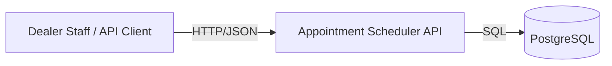
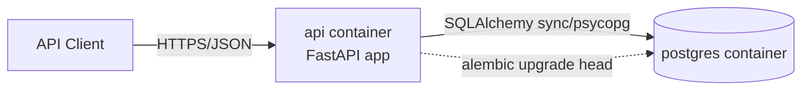
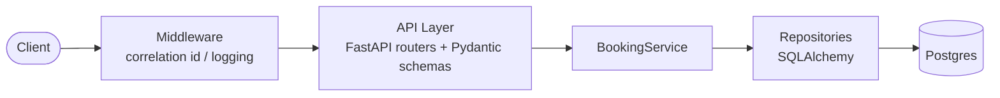
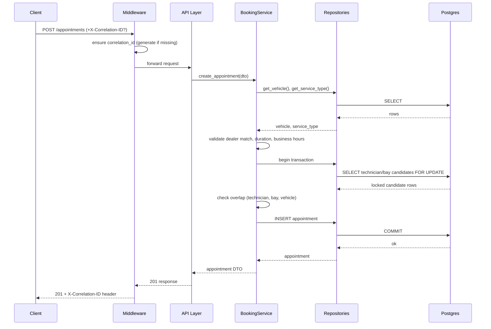
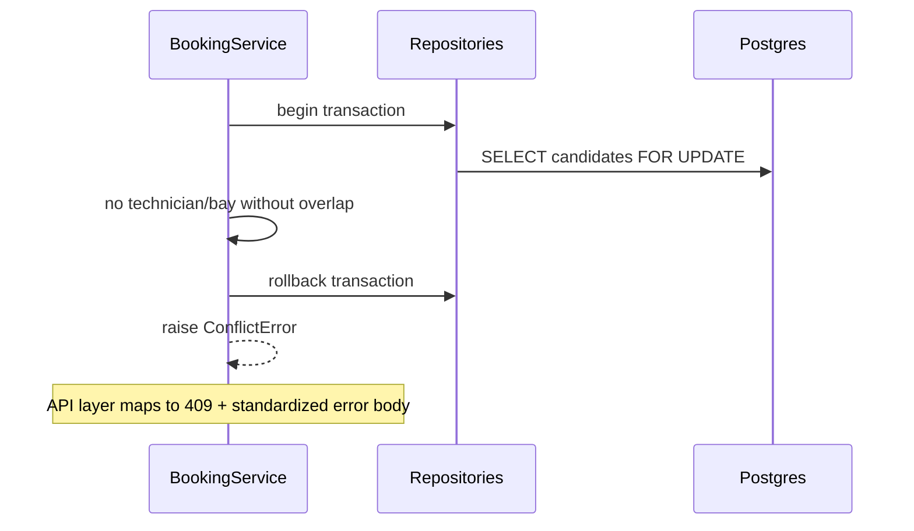

# System Architecture — Appointment Scheduler Backend

Companion document to [IMPLEMENTATION_PLAN.md](../IMPLEMENTATION_PLAN.md). Diagrams follow a lightweight C4 approach (System → Container → Component); Mermaid is used instead of UML for speed and GitHub-native rendering. No implementation code, contracts only.

---

## 1. System Context (C4 Level 1)

Who/what talks to the system, at the highest level.

The system is a single backend service consumed by an API client (no UI in scope). It owns all appointment/scheduling state in PostgreSQL and has no external service dependencies (no email, no payment, no third-party APIs).

---

## 2. Container View (C4 Level 2)

The two deployable units, matching `docker-compose.yml`.

- `api`: FastAPI application, stateless, horizontally scalable in principle (not exercised here).
- `postgres`: single Postgres instance, official image, no custom build.
- Alembic runs as a one-off command against the same database, not as a long-running container.

---

## 3. Component View (C4 Level 3)

Internal layering inside the `api` container, and how a request flows through it.

- **Middleware** runs first on every request: assigns/propagates `X-Correlation-ID`, times the request, emits the structured access log on the way out.
- **API layer** only translates HTTP ↔ DTOs; it does not contain business rules.
- **BookingService** owns the booking use case: validation → assignment → overlap check → transaction → persist. This is the only place the overlap/locking invariant is enforced.
- **Repositories** are the only code that talks SQLAlchemy; this is what makes `BookingService` unit-testable with fakes.

---

## 4. Sequence Diagram — `POST /appointments` (happy path)

## 5. Sequence Diagram — Overlap Conflict

---

## 6. Data Flow Summary

1. Request enters via middleware (correlation ID assigned/propagated, timer started).
2. API layer validates shape (Pydantic) and rejects malformed/forbidden fields (e.g. client-supplied `technician_id`).
3. Service layer validates business rules (Section 9 of the implementation plan) using data fetched via repositories.
4. Service layer opens a transaction, re-checks candidate resources with row locks, checks overlap, and inserts.
5. On success: response DTO built, structured log emitted with status/duration, correlation ID echoed in response header.
6. On failure at any step: transaction rolled back, exception mapped to the standardized error shape by the centralized handler.

---

## 7. Observability at a Glance

- Every request has exactly one `correlation_id` (propagated) and one `request_id` (generated fresh per request) — see ADR-003.
- Every response carries `X-Correlation-ID`.
- Every log line is structured JSON with: `request_id`, `correlation_id`, `method`, `path`, `status`, `duration_ms`, `user_agent`, `response_size`.
- `/health` reports process liveness _and_ DB connectivity, not just a static 200 (see Section 10 of the implementation plan).

---

## 8. Future Improvements (explicitly deferred)

- PostgreSQL `EXCLUDE USING gist` constraint to enforce no-overlap at the schema level (see ADR-005).
- Per-dealer configurable business hours instead of a system-wide constant.
- Metrics/tracing stack (OpenTelemetry/Prometheus) once there's real multi-instance traffic to observe.
- AuthN/AuthZ once there's a real caller identity model to enforce.

These are intentionally out of scope for a one-week assessment (see Section 3, Non-Goals, in the implementation plan) and are listed here so they read as deliberate choices, not gaps.
